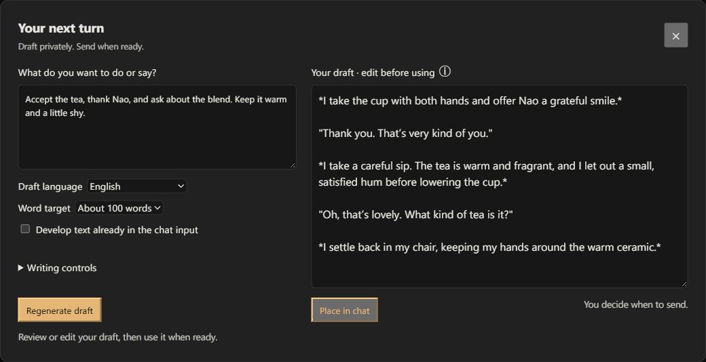
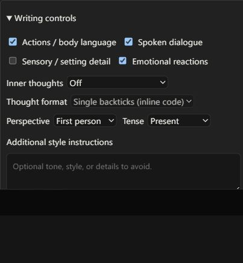

# Directed Reply for SillyTavern

**Describe what your character should do. Get a draft of your next roleplay message.**

Give a short direction such as “Accept the tea, thank Nao, and ask about the blend.” Directed Reply expands it into actions and dialogue using the current scene and your player persona. Edit the result, regenerate it, or place it in the chat input when you're ready to send.



*Staged demo of the extension UI. The draft is illustrative; wording and length depend on your model.*

**Direction → Generate draft → Review and edit → Place in chat → Send**

The extension writes **your character's turn**. It uses your existing SillyTavern model connection and conversation context. You choose what happens and approve the wording before sending a message.

## Install

Requires **SillyTavern 1.19.0 or later** and a connected model.

1. Open **Extensions → Install extension**.
2. Paste this repository URL:

   ```text
   https://github.com/keshon/SillyTavern-DirectedReply
   ```

3. Install, then reload SillyTavern.

No separate API key, server plugin, or build step is needed. Update through SillyTavern's extension manager.

### Check your model setup

- **Text Completion**, including KoboldCpp: for an instruction-following model, enable **Instruct Mode** under **AI Response Formatting** and select the model's matching Instruct and Context templates.
- **Chat Completion**: use your normal chat preset and Prompt Manager; Text Completion Instruct Mode isn't needed.
- If the model emits reasoning tags, configure **Reasoning → Auto-Parse** with its matching reasoning template.
- Set **Response (tokens)** high enough for the requested draft length. A word target does not raise the token limit.

See the [step-by-step setup and troubleshooting guide](docs/setup.md) for exact settings, persona setup, and common problems. Templates depend on the model; Directed Reply does not require Gemma or change your global model settings.

## Draft your next turn

1. Open a character or group chat.
2. Click the **pen nib after the magic wand**, beside the chat input.
3. Describe the action, words, or tone you want. Choose a **Draft language** and **Word target**.
4. Click **Generate draft**, or press **Ctrl+Enter** (**Cmd+Enter** on macOS) in the direction field.
5. Review the draft. Edit it directly or click **Regenerate draft**.
6. Click **Place in chat**. The draft goes into the normal chat input; send it when ready. Replacing existing input requires a separate confirmation.

### Give directions in one language, write in another

For example, enter:

> Беру чашку, благодарю за чай и спрашиваю, что это за сорт. Немного смущаюсь.

Select **English** to request an English reply. **Match conversation** follows the RP's language instead of the direction's language. The output-language list mirrors SillyTavern's available UI languages, with English as the default.

Direction, style, and preview placeholder hints follow ST's interface language, with English fallback. Other extension labels are currently English.

## Control the writing

Open **Writing controls** to choose what the draft may contain:

| Control | What it changes |
| --- | --- |
| Actions / body language | Action narration wrapped in `*asterisks*` |
| Spoken dialogue | Speech in double quotation marks |
| Inner thoughts | Off by default; allow only when requested, or include a brief thought |
| Thought format | Single backticks, a fenced code block, italics, or plain narration |
| Sensory / setting detail | Brief descriptions of established perceptions |
| Emotional reactions | Brief emotional cues supported by the scene |
| Perspective and tense | First/third person and present/past tense, or match the player |
| Additional style instructions | Tone, constraints, and details to avoid |

**Perspective** controls the draft's narration independently of your directions. With First person selected, a brief such as “we take the cup” or “мы берём чашку” requests narration as “I take the cup.” Third person uses the player in third person; Match player follows recent in-character narration. Dialogue can still use “we” when referring to a group.



*Writing controls in the staged demo. At least one of actions, dialogue, or inner thoughts must be allowed.*

Choose word targets from **25 to 500**, with 25-word steps through 300, or **Custom** for any integer from 25 to 1000. Targets are approximate; review the model's result.

The preview preserves Markdown and line breaks. The **ⓘ** beside its title explains formatting. In-character thoughts are separate from model reasoning; backticks are a display convention, not a universal RP syntax.

## Choose where to draft

Open **Extensions → Directed Reply → Draft window placement**.

| Placement | Where it opens |
| --- | --- |
| **Compact dock** (default) | Above the chat input; direction and preview sit side by side when space allows |
| **Conversation sidecar** | A full-height pane beside the chat; uses the dock below 1000px viewport width |
| **Focused workbench** | A larger dialog with directions and controls beside the editor, shown in the first screenshot |

All placements share the same editor and follow your ST theme. Switching preserves the current direction, draft, and pending generation. Placement and writing preferences are saved per SillyTavern user across chats and restarts.

## What is saved and sent?

- **Generate** sends the current direction, writing instructions, and configured scene context to your connected model. Normal model costs apply. Character context, World Info, and Author's Note follow your existing ST configuration.
- Directions stay outside chat history. Only the draft you place and send becomes a chat message. The extension does not append rejected drafts or old directions to later requests.
- **Stop** cancels the pending generation and preserves the previous preview. Closing the window keeps the current text during the page session and lets generation continue.
- Changing chats clears private draft text and cancels a pending request. Reloading clears directions and previews; saved preferences remain.

Your preset, lore, and other extensions can affect the result. Models can disregard language, length, or writing instructions, so review each draft before sending it.

## More help

- [Model setup and troubleshooting](docs/setup.md)
- [Development, tests, and context auditing](docs/development.md)
- [Report a problem](https://github.com/keshon/SillyTavern-DirectedReply/issues)

## License

[AGPL-3.0-only](LICENSE).
